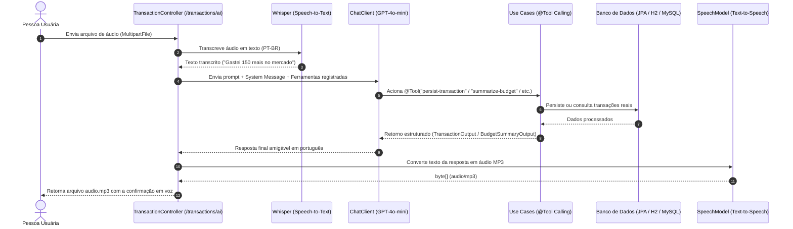

# 🏦 Itaú Budgeting AI — API Inteligente de Orçamento com Spring Boot & Spring AI

> **Projeto Final (Branch `projeto-final`) — Bootcamp Itaú: Java com Inteligência Artificial (DIO.me)**  
> Evolução do projeto base [`05-spring-ai`](https://github.com/digitalinnovationone/dio-spring-boot-learning-track/tree/main/05-spring-ai) mantendo **Clean Architecture & Domain-Driven Design (DDD)** com **Spring Boot 3.4**, **Spring AI**, **Tool Calling (`@Tool`)**, **Speech-to-Text (Whisper)** e **Text-to-Speech (TTS)**.

---

## 📌 1. O Que o Projeto Faz

Esta aplicação é uma **API Inteligente de Gestão de Orçamento Pessoal** capaz de processar tanto requisições REST tradicionais quanto **comandos naturais de voz (áudio) e texto** usando Inteligência Artificial Generativa.

### Fluxo Principal da API Inteligente



---

## 🚀 2. Qual Melhoria Foi Implementada (Evoluções sobre o Projeto Base)

A partir da arquitetura base construída em aula pelo expert Thiago Poiani, implementei **5 evoluções práticas** respeitando os limites entre `domain`, `application` e `infrastructure`:

1. **Nova Ferramenta Analítica para o Tool Calling (`SummarizeBudgetUseCase`)**:
   - Exposta ao modelo via `@Tool(name = "summarize-budget")`.
   - Calcula o **total gasto em reais**, **quantidade total de transações**, **ticket médio** e **subtotal agrupado por categoria**.
   - Permite que a pessoa usuária pergunte por voz ou texto: *"Qual é o resumo dos meus gastos até agora?"* e receba uma análise completa.
2. **Nova Ferramenta de Listagem Geral (`ListAllTransactionsUseCase`)**:
   - Exposta via `@Tool(name = "list-all-transactions")` e `GET /transactions` para consultar todo o histórico sem exigir filtro prévio.
3. **Validações Invariantes de Domínio & Tratamento Global de Erros (`Transaction` + `GlobalExceptionHandler`)**:
   - A entidade de domínio `Transaction` agora impede a criação de registros com descrição vazia, valor menor ou igual a zero (`amount <= 0`) ou categoria nula.
   - Adicionado `@RestControllerAdvice` retornando respostas padronizadas **RFC 7807 (`ProblemDetail`, HTTP 400 Bad Request)**.
4. **Expansão de Categorias & Conversão Exata Centavos ➡️ Reais**:
   - Categorias ampliadas: `GROCERIES`, `PHARMA`, `AUTO`, `RESTAURANT`, `EDUCATION`, `UTILITIES` e `ENTERTAINMENT`.
   - Conversão monetária precisa em `TransactionOutput` dividindo o valor em centavos por `100` com `BigDecimal` (`RoundingMode.HALF_UP`).
5. **Novo Endpoint de Comando por Texto (`POST /transactions/ai/text`) & Suíte de Testes Automatizados**:
   - Permite acionar o mesmo `ChatClient` e todas as `@Tool`s enviando JSON em texto, facilitando testes rápidos sem precisar gravar áudio.
   - Configuração híbrida de banco de dados (roda instantaneamente com **H2 in-memory** ou com **MySQL 9.6** via `compose.yml`).

---

## 🛠️ 3. Tecnologias Utilizadas

| Camada | Tecnologia / Biblioteca |
| :--- | :--- |
| **Linguagem** | Java 21 LTS (Records, Pattern Matching, Strong Typed IDs) |
| **Framework Base** | Spring Boot 3.4.3 (`spring-boot-starter-web`, `spring-boot-starter-data-jpa`) |
| **Inteligência Artificial** | Spring AI (`spring-ai-openai-spring-boot-starter`: `ChatClient`, `@Tool`, `OpenAiAudioTranscriptionModel`, `SpeechModel`) |
| **Banco de Dados** | H2 Database (padrão em memória) & MySQL 9.6 (`compose.yml`) |
| **Testes** | JUnit 5, Spring Boot Test (`@SpringBootTest`, `@Transactional`) |
| **Build** | Apache Maven 3.9+ |

---

## 📂 4. Arquitetura do Projeto (DDD & Clean Architecture)

```text
src/main/java/dio/budgeting/
├── BudgetingApplication.java
├── domain/                                  # Núcleo de Negócio (Puro, sem acoplamento com frameworks)
│   ├── Category.java                        # Enum de categorias financeiras
│   ├── Transaction.java                     # Entidade de domínio com validações invariantes
│   ├── TransactionId.java                   # Identificador fortemente tipado (Record + UUID)
│   └── TransactionRepository.java           # Contrato (Porta) do repositório
├── application/                             # Casos de Uso (Acionados via REST e via Spring AI @Tool)
│   ├── PersistTransactionUseCase.java       # @Tool("persist-transaction")
│   ├── ListTransactionsByCategoryUseCase.java # @Tool("list-transactions-by-category")
│   ├── ListAllTransactionsUseCase.java      # @Tool("list-all-transactions") [Evolução]
│   ├── SummarizeBudgetUseCase.java          # @Tool("summarize-budget") [Evolução]
│   ├── input/
│   │   └── PersistTransactionInput.java
│   └── output/
│       ├── TransactionOutput.java
│       └── BudgetSummaryOutput.java
└── infrastructure/                          # Adaptadores Externos (HTTP, Banco de Dados, IA)
    ├── http/
    │   ├── TransactionController.java       # Endpoints REST + Áudio + ChatClient
    │   ├── GlobalExceptionHandler.java      # Tratamento RFC 7807 ProblemDetail [Evolução]
    │   ├── request/
    │   │   ├── TransactionRequest.java
    │   │   └── AiTextCommandRequest.java
    │   └── response/
    │       ├── TransactionResponse.java
    │       └── AiTextCommandResponse.java
    └── persistence/
        ├── entity/
        │   └── TransactionEntity.java       # Entidade JPA
        └── repository/
            ├── TransactionEntityRepository.java
            └── JpaTransactionRepository.java
```

---

## ▶️ 5. Como Executar a Aplicação

### Pré-requisitos
- **Java 21 LTS**
- **Maven 3.9+**
- Chave da API OpenAI (necessária apenas para os endpoints `/transactions/ai` e `/transactions/ai/text`; os endpoints REST e testes locais funcionam imediatamente sem chave!).

### Passo 1: Configurar a variável de ambiente (Opcional para endpoints REST, obrigatório para IA)
```powershell
# PowerShell (Windows)
$env:OPENAI_API_KEY="sua_chave_openai_aqui"
```
```bash
# Linux / macOS / Git Bash
export OPENAI_API_KEY="sua_chave_openai_aqui"
```

### Passo 2: Rodar os testes automatizados
```bash
mvn test
```

### Passo 3: Iniciar o servidor Spring Boot
```bash
mvn spring-boot:run
```
A API iniciará em `http://localhost:8080`.

---

## 🧪 6. Como Testar o Fluxo Principal

### A. Criar uma transação via REST (`POST /transactions`)
```bash
curl -X POST http://localhost:8080/transactions \
  -H "Content-Type: application/json" \
  -d '{"description": "Supermercado Semanal", "category": "GROCERIES", "amount": 18590}'
```
**Resposta (`201 Created`):**
```json
{
  "id": "e4d2c3b1-...",
  "category": "GROCERIES",
  "description": "Supermercado Semanal",
  "amountInCents": 18590,
  "amount": 185.90
}
```

### B. Consultar o Resumo Analítico do Orçamento (`GET /transactions/summary`)
```bash
curl http://localhost:8080/transactions/summary
```
**Resposta (`200 OK`):**
```json
{
  "totalTransactions": 1,
  "totalAmountInCents": 18590,
  "totalValueInReais": 185.90,
  "averageValueInReais": 185.90,
  "totalByCategoryInReais": {
    "GROCERIES": 185.90
  }
}
```

### C. Enviar Comando de Voz para a IA (`POST /transactions/ai`)
```bash
curl -X POST http://localhost:8080/transactions/ai \
  -F "file=@src/test/resources/audio/comando.m4a" \
  --output resposta-assistente.mp3
```

### D. Enviar Comando em Texto para a IA com Tool Calling (`POST /transactions/ai/text`)
```bash
curl -X POST http://localhost:8080/transactions/ai/text \
  -H "Content-Type: application/json" \
  -d '{"message": "Gastei 65 reais na farmácia comprando vitaminas e depois quero saber meu resumo total"}'
```

---

## 💡 7. O Que Aprendi Durante o Desafio

1. **IA Respeitando Fronteiras de Arquitetura (DDD & Clean Architecture)**:
   - O modelo de linguagem (`ChatClient`) não acessa o banco de dados diretamente nem viola as regras de negócio. Ele atua como um orquestrador inteligente que invoca **Casos de Uso (`@Tool`)** da camada `application`, passando pelas mesmas validações do domínio (`Transaction`).
2. **Poder do Tool Calling (`@Tool` e `@ToolParam`)**:
   - Descrições semânticas claras nas anotações `@Tool` e `@ToolParam` permitem que o LLM escolha autonomamente entre persistir um gasto (`persist-transaction`), filtrar por categoria (`list-transactions-by-category`) ou consolidar um relatório (`summarize-budget`).
3. **Pipeline Multimodal (Áudio ➡️ Texto ➡️ Ação ➡️ Voz)**:
   - Combinar `OpenAiAudioTranscriptionModel` (Whisper), `ChatClient` e `SpeechModel` (TTS) transforma uma API REST tradicional em um assistente financeiro acessível por voz.
4. **Precisão Monetária**:
   - Trabalhar com centavos (`long amount`) no armazenamento e `BigDecimal` na apresentação evita erros clássicos de arredondamento em ponto flutuante.

---
*Projeto desenvolvido por Landerson durante o **Bootcamp Itaú - Java com Inteligência Artificial** na [DIO.me](https://www.dio.me/).*
