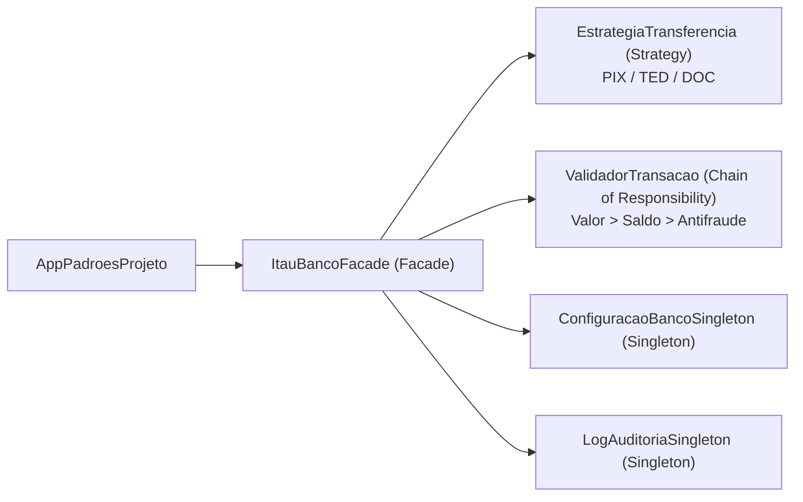

# ☕ Bootcamp Itaú - Java com Inteligência Artificial (DIO)

Repositório dedicado ao registro do meu aprendizado, anotações teóricas e resolução de exercícios práticos durante o **Bootcamp Itaú - Java com Inteligência Artificial**, promovido pela [DIO.me](https://www.dio.me/) em parceria com o **Itaú**.

---

## 🎯 Objetivos de Aprendizado

- [x] Configuração de ambiente e entendimento do Classpath no Java
- [x] Entrada e saída de dados no console (`Scanner`, `print`, `println`, `printf`)
- [x] Gerenciamento de recursos e prevenção de vazamentos de memória (`Resource leak`)
- [x] Domínio dos operadores fundamentais do Java
- [x] Resolução de desafios práticos com regras de negócio simuladas
- [x] Estruturas de repetição (`while`, `for`, `do-while`)
- [x] Programação Orientada a Objetos (Abstração, Encapsulamento, Herança, Polimorfismo, Interfaces e Lambdas)
- [x] Desafio Final: Padrões de Projeto (Design Patterns GoF) na Prática
- [ ] Integrações com IA e Spring Boot

---

## 📚 Conceitos Praticados

### 1. Entrada e Saída de Dados
- **`Scanner` (`java.util.Scanner`)**: Captura de dados digitados pelo usuário via terminal (`System.in`).
  - `.nextLine()`: Leitura de textos (`String`).
  - `.nextInt()`: Leitura de inteiros (`int`).
  - `.nextDouble()`: Leitura de números com ponto flutuante (`double`).
- **Gerenciamento de Recursos**:
  - Toda instância de `Scanner` aberta sobre fluxos do sistema deve ser explicitamente finalizada com `scanner.close()` ao término do uso para evitar avisos de *Resource leak*.

### 2. Diferenças entre `print`, `println` e `printf`

| Método | Pula linha no final? | Permite formatação de variáveis? | Exemplo |
| :--- | :---: | :---: | :--- |
| **`print()`** | ❌ Não | ❌ Não (usa `+`) | `System.out.print("Olá ");` |
| **`println()`** |  Sim | ❌ Não (usa `+`) | `System.out.println("Olá Mundo!");` |
| **`printf()`** | ❌ Não (usa `%n`) |  Sim (máscaras) | `System.out.printf("Nome: %s \| Nota: %.2f%n", nome, nota);` |

- **Principais máscaras do `printf`**:
  - `%s`: Texto (`String`)
  - `%d`: Inteiro (`int`, `long`)
  - `%.2f`: Decimal com 2 casas (`double`, `float`)
  - `%n`: Quebra de linha multiplataforma

---

### 3. Operadores em Java

- **Aritméticos**: `+` (adição), `-` (subtração), `*` (multiplicação), `/` (divisão), `%` (módulo / resto da divisão inteira).
- **Relacionais**: `==` (igual), `!=` (diferente), `>` (maior), `<` (menor), `>=` (maior ou igual), `<=` (menor ou igual).
- **Lógicos**:
  - `&&` (*AND* / E): Verdadeiro se ambas as condições forem verdadeiras.
  - `||` (*OR* / OU): Verdadeiro se ao menos uma condição for verdadeira.
  - `!` (*NOT* / NÃO): Inversão lógica (ex: `!temRestricao`).
- **Atribuição Composta e Unários**:
  - `+=`, `-=`, `*=`, `/=`: Atualizam o valor aplicando a operação.
  - `++`, `--`: Incremento e decremento unitário.
- **Operador Ternário (`? :`)**:
  - Substitui condicionais simples de atribuição:
    ```java
    String status = aprovado ? "APROVADO" : "REPROVADO";
    ```

---

## 🛠️ Exercícios Desenvolvidos

A estrutura de código está organizada em pacotes modulares dentro de `src/main/java/`:

```text
src/main/java/
├── exercicio1/
│   └── Exercicio1.java    # Calculadora de Média com formatação printf
├── exercicio2/
│   └── Exercicio2.java    # Sistema Bancário de Aprovação de Empréstimo (Itaú)
├── exercicio3/
│   └── Exercicio3.java    # Verificador Par/Ímpar, Módulo e Acumulador de Pontos
├── exercicio4/
│   └── Exercicio4.java    # Terminal de Autoatendimento Itaú (Switch Case & Do-While)
├── exercicio5/
│   └── Exercicio5.java    # Simulador de Investimentos CDB Itaú (Laço FOR e Juros Compostos)
├── exercicio6/
│   ├── ContaCorrente.java # Classe de Modelo POO (Abstração, Encapsulamento, Cheque Especial)
│   └── Exercicio6.java    # Aplicação Executável com Menu Interativo do Itaú
├── exercicio7/
│   ├── ContaBancaria.java # Superclasse Mãe (Herança, Protected)
│   ├── ContaCorrente.java # Subclasse com Polimorfismo (@Override sacar com taxa e cheque)
│   ├── ContaPoupanca.java # Subclasse com Polimorfismo e Rendimento de Juros
│   └── Exercicio7.java    # Executável de Demonstração de Polimorfismo
├── exercicio8/
│   ├── Tributavel.java             # Interface de Contrato Tradicional
│   ├── ContaInvestimento.java      # Implementação 1 da Interface Tributavel
│   ├── SeguroDeVida.java           # Implementação 2 da Interface Tributavel
│   ├── CalculadoraDeTributos.java  # Polimorfismo genérico com Interface
│   ├── ServicoNotificacao.java     # @FunctionalInterface para Lambdas
│   └── Exercicio8.java             # Executável com Expressões Lambda (SMS, App, WhatsApp)
├── desafio/
│   └── Main.java                   # Desafio de Código ByteBank (POO e Exceções)
└── padroesprojeto/                 # 🏆 Desafio de Projeto: Design Patterns (GoF)
    ├── AppPadroesProjeto.java      # Executável demonstrando todos os padrões integrados
    ├── model/
    │   └── ContaDigital.java
    ├── singleton/
    │   ├── ConfiguracaoBancoSingleton.java
    │   └── LogAuditoriaSingleton.java
    ├── strategy/
    │   ├── EstrategiaTransferencia.java
    │   ├── TransferenciaPix.java
    │   ├── TransferenciaTed.java
    │   └── TransferenciaDoc.java
    ├── chain/
    │   ├── ValidadorTransacao.java
    │   ├── ValidadorValorPositivo.java
    │   ├── ValidadorSaldoDisponivel.java
    │   └── ValidadorAntifraude.java
    └── facade/
        └── ItauBancoFacade.java
```

### [Exercício 1: Calculadora de Média Escolar](src/main/java/exercicio1/Exercicio1.java)
- **Foco**: Entrada via `Scanner`, média aritmética com precedência de operadores e saída formatada com `printf` e `%.2f`.
- **Destaque**: Utilização de `var` para inferência de tipo moderno no Java.

### [Exercício 2: Análise de Crédito Bancário](src/main/java/exercicio2/Exercicio2.java)
- **Foco**: Simulação de regras de concessão de crédito do Itaú.
- **Regra de negócio**:
  - Idade entre 18 e 65 anos (`idade >= 18 && idade <= 65`).
  - Renda mensal mínima de R$ 2.500,00 (`renda >= 2500.00`).
  - Ausência de restrição cadastral (`!temRestricao`).
- **Destaque**: Uso do operador ternário para decisão de mensagem em linha única.

### [Exercício 3: Verificador Par/Ímpar com Pontuação](src/main/java/exercicio3/Exercicio3.java)
- **Foco**: Uso do operador de resto `%` para determinar paridade (`numero % 2 == 0`).
- **Regras aplicadas**:
  - Par: `pontos += 20`
  - Ímpar: `pontos -= 10`
  - Bônus para números > 100: `pontos++`

### [Exercício 4: Terminal de Autoatendimento Itaú](src/main/java/exercicio4/Exercicio4.java)
- **Foco**: Controle de fluxo com `switch case` moderno (syntax de flechas `->`) e blocos de múltiplas instruções com `{ }`.
- **Destaque**:
  - Implementação de laço `do-while` para manter o menu ativo até a opção de saída (`4`).
  - Domínio de escopo de variáveis no Java (`opcao` declarada fora do loop).
  - Operações de saldo com validação de saque e operadores de atribuição composta (`+=`, `-=`).

### [Exercício 5: Simulador de Investimentos CDB Itaú](src/main/java/exercicio5/Exercicio5.java)
- **Foco**: Repetição controlada com laço `for (int mes = 1; mes <= meses; mes++)` simulando juros compostos.
- **Destaque**:
  - Separação clara entre a variável contadora do laço (`mes`) e o cálculo financeiro (`rendimento`).
  - Formatação monetária com `printf` utilizando `%02d` para dígitos de meses e `%.2f` para valores decimais.
  - Exibição de resumo final de lucro e saldo fora do laço de repetição.

### [Exercício 6: Modelagem de Conta Corrente e Menu Interativo](src/main/java/exercicio6/Exercicio6.java)
- **Foco**: Fundamentos de Programação Orientada a Objetos (POO): **Abstração** e **Encapsulamento**.
- **Destaque**:
  - Criação da classe de modelo `ContaCorrente` com atributos `private`, construtor e métodos com validação de regras de negócio (`depositar`, `sacar` com cheque especial, `exibirExtrato`).
  - Criação de menu de autoatendimento no terminal integrando o objeto instanciado via `new` ao laço `do-while` e `switch`.

### [Exercício 7: Herança e Polimorfismo Bancário](src/main/java/exercicio7/Exercicio7.java)
- **Foco**: Pilares de **Herança** (`extends`, `super`, `protected`) e **Polimorfismo** (`@Override`).
- **Destaque**:
  - Superclasse `ContaBancaria` centralizando atributos e comportamentos comuns a todas as contas.
  - Subclasse `ContaCorrente` sobrescrevendo `sacar` com taxa operacional de R$ 2,50 e cheque especial.
  - Subclasse `ContaPoupanca` com cálculo e aplicação de rendimento de juros.
  - Demonstração prática de polimorfismo no método `sacar`.

### [Exercício 8: Interfaces e Expressões Lambda no Itaú](src/main/java/exercicio8/Exercicio8.java)
- **Foco**: **Interfaces** (contratos de desacoplamento) e **Expressões Lambda** (`->`).
- **Destaque**:
  - Criação da interface `Tributavel` implementada por classes distintas (`ContaInvestimento` e `SeguroDeVida`), processadas por uma `CalculadoraDeTributos` agnóstica.
  - Uso de `@FunctionalInterface` com `ServicoNotificacao` para envio de mensagens.
  - Implementação de canais de notificação (SMS, Push Notification App Itaú, WhatsApp) em linha única com sintaxe de Lambdas (`(msg, dest) -> ...`).
  - Passagem de Lambdas como argumento de métodos ("on-the-fly").

---

## 🏆 Desafio de Projeto Final: Padrões de Projeto (Design Patterns GoF)

Projeto prático em **Java 21 Puro** aplicando 4 padrões clássicos do catálogo **Gang of Four (GoF)** de forma integrada em um motor de transferências bancárias do **Itaú**:



| Categoria | Padrão GoF | Classes Implementadas | Responsabilidade |
| :--- | :--- | :--- | :--- |
| **Criacional** | **Singleton** (Lazy Holder) | `ConfiguracaoBancoSingleton`, `LogAuditoriaSingleton` | Garantir instância única e *thread-safe* para configurações globais do banco (limite antifraude) e log centralizado de auditoria. |
| **Comportamental** | **Strategy** | `EstrategiaTransferencia`, `TransferenciaPix`, `TransferenciaTed`, `TransferenciaDoc` | Encapsular regras de cálculo de tarifas intercambiáveis em tempo de execução sem `if/else` acoplados. |
| **Comportamental** | **Chain of Responsibility** | `ValidadorTransacao`, `ValidadorValorPositivo`, `ValidadorSaldoDisponivel`, `ValidadorAntifraude` | Processar validações de segurança e saldo em cadeia desacoplada antes de efetivar a movimentação. |
| **Estrutural** | **Facade** | `ItauBancoFacade` | Expor uma interface única e limpa (`realizarTransferencia`), escondendo toda a orquestração dos subsistemas acima. |

---

## 💡 Aprendizados e Boas Práticas Anotadas

1. **Clean Code em Nomenclaturas**:
   - Evitar acentos e caracteres especiais em nomes de variáveis (ex: usar `ehPar` ou `isPar` ao invés de `éPar`) para garantir compatibilidade com qualquer padrão de codificação e pipeline CI/CD.
2. **Robustez em Entradas do Usuário**:
   - Para leitura de opções em sistemas reais, preferir ler texto com `.trim().toLowerCase()` e validar contra coleções/conjuntos (`Set.of(...)`), evitando exceções de formato causadas por `nextBoolean()`.
3. **Estrutura de Pastas e Classpath**:
   - Códigos Java em projetos estruturados devem sempre residir dentro de `src/main/java` para que a IDE e os compiladores reconheçam os arquivos no *classpath* corretamente.

---

## 🚀 Como Executar os Exercícios

Com o Java 21 instalado, você pode executar qualquer exercício pelo terminal na raiz do projeto:

```bash
# Executar Exercício 1
java src/main/java/exercicio1/Exercicio1.java

# Executar Exercício 2
java src/main/java/exercicio2/Exercicio2.java

# Executar Exercício 3
java src/main/java/exercicio3/Exercicio3.java

# Executar Exercício 4
java src/main/java/exercicio4/Exercicio4.java

# Executar Exercício 5
java src/main/java/exercicio5/Exercicio5.java

# Executar Exercício 6
java -cp target/classes exercicio6.Exercicio6

# Executar Exercício 7
java -cp target/classes exercicio7.Exercicio7

# Executar Exercício 8
java -cp target/classes exercicio8.Exercicio8

# Executar Desafio Final - Padrões de Projeto (GoF)
javac -encoding UTF-8 -d target/classes (Get-ChildItem -Path src\main\java\padroesprojeto -Recurse -Filter *.java).FullName
java -cp target/classes padroesprojeto.AppPadroesProjeto
```

---
*Estudos realizados por mim durante o Bootcamp Itaú - Java com IA na plataforma DIO.me.*
